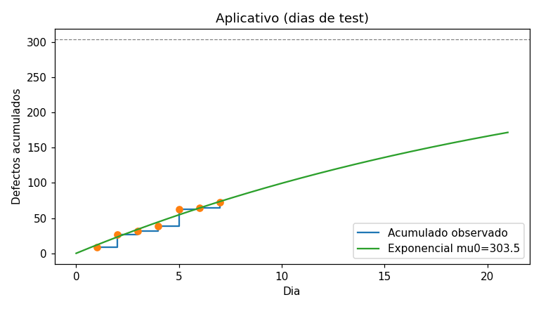
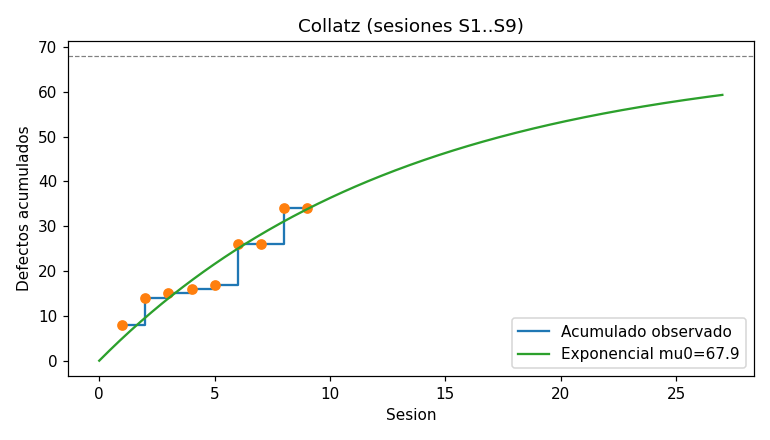

# TP11 - Gestión de Calidad

**Ingeniería de Software II — UADER FCyT** · Julian Olivera

| Carpeta | Contenido |
|---------|-----------|
| [`collatz/`](collatz/) | programa original (`collatz_original.py`), versión corregida (`collatz.py`), casos de test unitarios y funcionales |
| [`defectos/`](defectos/) | modelo de proyección de defectos (`proyeccion_defectos.py`) y gráficos |
| [`json2csv/`](json2csv/) | herramienta JSON → CSV con CI/CD (ver su [README](json2csv/README.md)) |
| `TP11_Respuestas_OliveraJulian.pdf` | este documento en PDF |

---

## 1. Conjetura de Collatz

### 1.1 Requerimientos

**Funcionales — R = {R1, …, R5}**

| ID | Requerimiento |
|----|---------------|
| R1 | Solicitar por teclado un número al usuario. |
| R2 | Aceptar sólo números **enteros positivos** (rechazar 0, negativos, decimales, texto y entrada vacía). |
| R3 | Calcular el número de iteraciones de la operación de Collatz (par → n/2, impar → 3n+1) necesarias para alcanzar el valor 1. |
| R4 | Imprimir el número de partida y el número de iteraciones. |
| R5 | Limitar a **1999** el entero máximo a validar (rechazar valores > 1999). |

**No funcionales — F = {F1, …, F6}**

| ID | Requerimiento |
|----|---------------|
| F1 | Implementado en Python 3, ejecutable sin dependencias externas. |
| F2 | Tasa de comentarios: como máximo **12 líneas de código por comentario** (una tasa mayor a 12 es defecto). |
| F3 | Robustez: ante entrada inválida o fin de entrada (EOF) el programa no termina con un *traceback*. |
| F4 | Rendimiento: el cálculo de todo el rango válido [1, 1999] demora menos de 1 segundo. |
| F5 | Testabilidad: la lógica de cálculo es importable sin efectos secundarios (no imprime ni pide datos al importarse). |
| F6 | Usabilidad: los errores se informan con un mensaje claro y se vuelve a solicitar el número. |

### 1.2 Casos de test — T = {T1, …, T26}

Unitario = caja blanca (llama a las funciones `collatz()` / `validar_entrada()` conociendo su estructura). Funcional = caja negra (ejecuta el programa, alimenta el teclado por *stdin* y observa sólo la salida).

| ID | Tipo | Entrada | Resultado esperado | Sesión de alta |
|----|------|---------|--------------------|----------------|
| T01 | Unitario | `collatz(1)` | 0 (no entra al ciclo) | inicial |
| T02 | Unitario | `collatz(2)` | 1 (rama par) | inicial |
| T03 | Unitario | `collatz(3)` | 7 (rama impar) | inicial |
| T04 | Unitario | `collatz(20)` | 7 (ejemplo del enunciado) | inicial |
| T05 | Unitario | `collatz(27)` | 111 (secuencia larga) | inicial |
| T06 | Unitario | `collatz(1999)` | 50 (límite superior) | inicial |
| T07 | Unitario | `validar_entrada("0")` | `ValueError` | inicial |
| T08 | Unitario | `validar_entrada("-5")` | `ValueError` | inicial |
| T09 | Unitario | `validar_entrada("2000")` | `ValueError` | inicial |
| T10 | Unitario | `validar_entrada("abc")` | `ValueError` | inicial |
| T11 | Unitario | `validar_entrada("1")`, `("1999")` | 1 y 1999 | inicial |
| T12 | Funcional | `20` | "El número de iteraciones para 20 es 7", código 0 | inicial |
| T13 | Funcional | `1` | "… para 1 es 0" | inicial |
| T14 | Funcional | `1999` | "… para 1999 es 50" | inicial |
| T15 | Funcional | `2000` | mensaje "Error", sin traceback | inicial |
| T16 | Funcional | `0` | mensaje "Error", sin traceback | inicial |
| T17 | Funcional | `-3` | mensaje "Error", sin traceback | inicial |
| T18 | Funcional | `abc` | mensaje "Error", sin traceback | inicial |
| T19 | Unitario | código fuente | ≤ 12 LOC por comentario | inicial |
| T20 | Unitario | `collatz(n)`, n = 1..1999 | < 1 s | inicial |
| T21 | Unitario | `validar_entrada("3.5")` | `ValueError` | sesión 2 |
| T22 | Unitario | `validar_entrada("")` | `ValueError` | sesión 2 |
| T23 | Unitario | `validar_entrada("  27  ")` | 27 | sesión 2 |
| T24 | Funcional | EOF sin datos | sin traceback, código 1 | sesión 2 |
| T25 | Funcional | `abc` y luego `20` | "Error", reintento y "… para 20 es 7" | sesión 2 |
| T26 | Unitario | `import collatz` | no imprime nada | sesión 2 |

Implementación: [`collatz/test_unitarios.py`](collatz/test_unitarios.py) y [`collatz/test_funcionales.py`](collatz/test_funcionales.py).

### 1.3 Matriz de trazabilidad RTMX (R ∪ F ⇔ T)

| Req. | Casos de test | Cubierto |
|------|---------------|:--------:|
| R1 | T12, T13, T14, T25 | ✔ |
| R2 | T07, T08, T10, T11, T16, T17, T18, T21, T22, T23 | ✔ |
| R3 | T01, T02, T03, T04, T05, T06, T12, T13, T14 | ✔ |
| R4 | T12, T13, T14, T25 | ✔ |
| R5 | T06, T09, T11, T14, T15 | ✔ |
| F1 | T12 (ejecución con el intérprete Python 3, sin dependencias) | ✔ |
| F2 | T19 | ✔ |
| F3 | T15, T16, T17, T18, T24 | ✔ |
| F4 | T20 | ✔ |
| F5 | T26 | ✔ |
| F6 | T15, T16, T17, T18, T25 | ✔ |

**Validación de integridad.** Con el conjunto inicial (T01–T20) la matriz tenía una fila vacía: **F5 no tenía casos de prueba**, y R1/F3/F6 sólo se cubrían con un único intento de entrada (no se probaba el reintento ni el EOF). Esas brechas se cerraron en la sesión 2 (T21–T26). Con la matriz final todo requerimiento tiene al menos un caso de test y todo caso de test traza al menos a un requerimiento (no hay casos huérfanos).

### 1.4 Sesión 1 — Inspección del código (sin ejecutar)

| # | Línea | Tipo | Defecto |
|---|-------|------|---------|
| D1 | 13 | Sintáctico | `print(` sin paréntesis de cierre → `SyntaxError`. |
| D2 | 10 | Semántico | `return iter` devuelve la función *built-in* `iter` en lugar de `iteraciones` (además deja un espacio al final). |
| D3 | 13 | Semántico | `collatz(j)`: la variable `j` no está definida (debería ser `i`) → `NameError`. |
| D4 | 12 | Semántico | El número está fijo (`i=20`): no se solicita por teclado (R1). |
| D5 | 2–9 | Semántico | No se valida que el número sea positivo: con 0 o negativos el `while` nunca termina (R2). |
| D6 | — | Semántico | No se valida el máximo de 1999 (R5). |
| D7 | — | Semántico | No hay manejo de entradas no numéricas (R2/F3). |
| D8 | 11–13 | Semántico | Código de prueba a nivel de módulo, sin `if __name__ == "__main__"`: importar el módulo ejecuta el `print` e impide la prueba unitaria (F5). |

Tasa de comentarios: 2 comentarios en 18 LOC (13 líneas físicas) → 9 LOC/comentario ≤ 12 → **no es defecto**.

**Defectos detectados en la sesión 1: 8.**

### 1.5 Sesión 2 — Inspección de los casos de test

Se inspeccionó el conjunto T01–T20 contra los requerimientos y la RTMX. Defectos del conjunto de prueba:

1. No se prueba un número decimal (`3.5`) → se agrega **T21**.
2. No se prueba la entrada vacía → **T22**.
3. No se prueba una entrada válida con espacios → **T23**.
4. No se prueba el fin de entrada (EOF) → **T24**.
5. No se prueba el reintento después de una entrada inválida (R1 + F6) → **T25**.
6. F5 (testabilidad) no tiene casos asociados → **T26**.

La RTMX se actualizó con cada caso agregado (tabla 1.3). **Defectos detectados en la sesión 2: 6.**

### 1.6 Sesiones de ejecución de test unitarios (S3 – S7)

Se ejecutan todos los casos unitarios (`python -m pytest test_unitarios.py`). Entre sesiones se corrigen **todas** las fallas observadas en la sesión anterior (y sólo esas).

| Sesión | Resultado observado | Defectos | Corrección aplicada antes de la siguiente |
|--------|---------------------|:--------:|--------------------------------------------|
| S3 | `SyntaxError: '(' was never closed` — no se puede importar el módulo; 0 casos ejecutados. | 1 | Cerrar el paréntesis del `print`. |
| S4 | `NameError: name 'j' is not defined` al importar; 0 casos ejecutados. | 1 | `collatz(j)` → `collatz(i)`. |
| S5 | `TypeError: %d format: a real number is required, not builtin_function_or_method`; 0 casos ejecutados. | 1 | `return iter` → `return iteraciones`. |
| S6 | 8 pasan; fallan T07, T08, T09, T10, T11, T21, T22, T23 (no existe `validar_entrada`) y T26 (el import imprime). | 9 | Se agrega `validar_entrada()` (entero en [1, 1999]) y el código de prueba pasa a `if __name__ == "__main__"`. |
| S7 | **17/17 pasan.** | 0 | — |

### 1.7 Sesiones de ejecución de test funcionales (S8 – S9)

Se ejecutan todos los casos funcionales (`python -m pytest test_funcionales.py`) repitiendo en cada sesión todos los de la sesión previa.

| Sesión | Resultado observado | Defectos | Corrección aplicada |
|--------|---------------------|:--------:|---------------------|
| S8 | Sólo pasa T12 (el valor fijo era 20). Fallan T13, T14 (no lee el teclado), T15–T18 (no hay mensaje de error), T24 (no maneja EOF) y T25 (no reintenta). | 8 | Se agrega `main()`: pide el número con `input()`, valida con `validar_entrada()`, informa "Error" y vuelve a pedir, maneja `EOFError` (código 1) y sale con `sys.exit(main())`. |
| S9 | **9/9 pasan.** | 0 | — |

Regresión final (`python -m pytest` en `collatz/`): **26/26 casos exitosos.**

### 1.8 Verificación de condiciones finales

- ✔ Todos los casos de prueba fueron ejecutados exitosamente al menos una vez (unitarios en S7, funcionales en S9, todos en la regresión final).
- ✔ No hubo caso de test sin ejecutar (T01–T26 figuran en S7/S9).
- ✔ No hay requerimiento funcional ni no funcional sin verificar (RTMX 1.3 con todas las filas cubiertas y en verde).

### 1.9 Listado de sesiones y defectos

La numeración es global: S1–S2 inspección, S3–S7 unitarias, S8–S9 funcionales.

| Sesión | Fase | Defectos |
|--------|------|:--------:|
| S1 | Inspección (código) | 8 |
| S2 | Inspección (casos de test) | 6 |
| S3 | Unitario | 1 |
| S4 | Unitario | 1 |
| S5 | Unitario | 1 |
| S6 | Unitario | 9 |
| S7 | Unitario | 0 |
| S8 | Funcional | 8 |
| S9 | Funcional | 0 |
| **Total** | **9 sesiones** | **34** |

### 1.10 PCE por fase

Con 100% = 34 defectos observados:

| Fase | Defectos | % del total | PCE acumulado | PCE de contención (fase / (fase + posteriores)) |
|------|:--------:|:-----------:|:-------------:|:--------------------:|
| Inspección | 14 | 41,2% | 41,2% | 14/34 = 41,2% |
| Unitario | 12 | 35,3% | 76,5% | 12/20 = 60,0% |
| Funcional | 8 | 23,5% | 100,0% | 8/8 = 100,0% |

### 1.11 Densidad de defectos al comienzo del test

δ0 = defectos / tamaño = 34 / 18 LOC = **1,89 def/LOC** (≈ 1889 def/KLOC).

Si se cuentan sólo los defectos de código distintos encontrados en la inspección (8), δ0 = 8/18 = 0,44 def/LOC; la diferencia muestra cuánto pesan en el conteo los defectos del conjunto de prueba y las fallas repetidas por ejecución.

---

## 2. Kanban: parámetro TEP

El **TEP (Trabajo En Proceso)** es el equivalente del WIP (*Work In Progress*): la cantidad máxima de ítems de trabajo que pueden estar simultáneamente en una columna (etapa) del tablero o en todo el flujo. Es lo que convierte al tablero en un **sistema *pull***: una etapa sólo "tira" un nuevo ítem cuando tiene capacidad libre por debajo de su TEP.

Su significado crítico es que es la **palanca de control del flujo**. Por la ley de Little, *tiempo de ciclo = TEP / throughput*: con el mismo ritmo de entrega, cuanto más trabajo se acumula en proceso, más tarda cada ítem en salir. Un TEP demasiado alto oculta los cuellos de botella, fomenta la multitarea y el cambio de contexto, alarga los tiempos de entrega y aumenta los defectos; uno demasiado bajo deja recursos ociosos y frena el flujo. Por eso el límite debe respetarse: cuando una columna llega a su TEP no se empieza nada nuevo, sino que el equipo se concentra en terminar o destrabar lo que ya está en curso ("dejar de empezar, empezar a terminar"). Si el límite se ignora o se fija sin medir, el tablero pasa a ser una simple lista de tareas y se pierde la capacidad de detectar y gestionar las restricciones del proceso.

---

## 3. Proyección de defectos por regresión

Modelo ([`defectos/proyeccion_defectos.py`](defectos/proyeccion_defectos.py)), aplicado sobre los defectos **acumulados** M(t):

- **Exponencial (Goel–Okumoto)**: M(t) = μ0 · (1 − e^(−b·t)); se ajusta por mínimos cuadrados y μ0 es la asíntota (total de defectos esperado).
- **Lineal de tasa** (control): defectos del período vs acumulado previo, d_t = a − k·M(t−1); la intersección con el eje (a/k) estima μ0.

### 3.1 Dataset del aplicativo (días 0–6)

| Día | 0 | 1 | 2 | 3 | 4 | 5 | 6 |
|-----|---|---|---|---|---|---|---|
| Defectos | 9 | 18 | 5 | 7 | 23 | 2 | 8 |
| Acumulado | 9 | 27 | 32 | 39 | 62 | 64 | 72 |

| Modelo | μ0 estimado | Parámetros |
|--------|:-----------:|------------|
| Exponencial | **≈ 304** | b = 0,0397, R² = 0,964 |
| Lineal de tasa | ≈ 140 | a = 13,51, k = 0,0968 |

Con 72 defectos detectados quedarían entre ≈ 68 (lineal) y ≈ 232 (exponencial) por encontrar. La serie es muy irregular (picos los días 1 y 4) y todavía **no muestra una tendencia decreciente clara**, por lo que la curva exponencial casi no se curva y su asíntota es poco estable: la estimación debe tomarse como un rango (≈ 140–300 defectos) y recalcularse a medida que se sumen días de test.

### 3.2 Dataset de Collatz (sesiones S1–S9)

| Sesión | S1 | S2 | S3 | S4 | S5 | S6 | S7 | S8 | S9 |
|--------|----|----|----|----|----|----|----|----|----|
| Defectos | 8 | 6 | 1 | 1 | 1 | 9 | 0 | 8 | 0 |
| Acumulado | 8 | 14 | 15 | 16 | 17 | 26 | 26 | 34 | 34 |

| Modelo | μ0 estimado | Parámetros |
|--------|:-----------:|------------|
| Exponencial | **≈ 67,9** | b = 0,0765, R² = 0,900 |
| Lineal de tasa | ≈ 40,6 | a = 6,59, k = 0,1623 |

Tamaño final del código: `cat collatz.py | wc -l` → **48 LOC**.

Defectos identificados en las etapas de test: Σμi = 14 + 12 + 8 = **34**.

| | Exponencial | Lineal de tasa |
|---|:---:|:---:|
| μ0 proyectado | 67,9 | 40,6 |
| μr = μ0 − Σμi (liberados) | **33,9** | 6,6 |
| Densidad total proyectada μ0 / 48 LOC | 1,41 def/LOC | 0,85 def/LOC |
| Densidad liberada δr = μr / 48 LOC | **0,71 def/LOC** | 0,14 def/LOC |

El modelo exponencial resulta pesimista porque las sesiones S6 y S8 (cambio de fase: aparecen fallas nuevas al ejecutar otro tipo de test) rompen la tendencia decreciente; la fase de prueba por sí sola no alcanza para asegurar que el programa esté libre de defectos.

---

## 4. Marco para evaluar garantía: efecto de aumentar el PCE

En el marco de garantía el costo total de un producto es la suma del **costo de test** (crece con el tiempo de test) y del **costo de garantía** (proporcional a los defectos que se liberan, μr, que decrecen con el tiempo de test siguiendo la curva de descubrimiento). El tiempo de test óptimo T\* es el que minimiza esa suma, es decir, donde el costo marginal de seguir probando iguala al ahorro marginal en garantía.

Aumentar el PCE significa que el proceso contiene una fracción mayor de los defectos antes de la liberación: la curva de defectos descubiertos sube más rápido y μr cae más rápido para cada unidad de tiempo de test. Cualitativamente:

- El **tiempo total de test óptimo T\* se reduce** (se alcanza antes el nivel de defectos remanentes que hace conveniente liberar).
- El **costo total en el óptimo baja**, porque se libera con menos defectos y se gasta menos en test.
- Para un mismo nivel de riesgo de garantía (μr objetivo) se necesita menos tiempo de test, por lo que es posible **otorgar garantía antes y con menor reserva**.
- El efecto tiene rendimientos decrecientes: a PCE muy alto, cada punto adicional reduce poco T\* porque quedan pocos defectos por contener.

---

## 5. Línea de base organizacional (PCE = 89%, δr = 0,12 def/FP, S = 100 FP)

Relaciones: μr = δr · S y PCE = (μ0 − μr) / μ0 ⇒ μ0 = μr / (1 − PCE).

**a. Defectos totales esperados**

μr = 0,12 × 100 = 12 defectos liberados ⇒ μ0 = 12 / (1 − 0,89) = 12 / 0,11 = **109,1 ≈ 109 defectos**.

**b. Densidad de defectos al finalizar la construcción**

δ0 = μ0 / S = 109,1 / 100 = **1,09 def/FP**.

**c. Defectos a detectar en V&V**

μ0 − μr = PCE · μ0 = 0,89 × 109,1 = **97,1 ≈ 97 defectos**.

**d. 20 defectos por día en los primeros 3 días (60 en total)**

Se encontró en 3 días el 62% de los 97 defectos planificados **sin ninguna disminución en la tasa diaria**. Si el proyecto se comportara según la línea de base (μ0 ≈ 109 con un descubrimiento exponencial), para llegar a 60 defectos en 3 días la curva sería 1 − e^(−3b) = 60/109,1 ⇒ b ≈ 0,266, y el perfil diario esperado sería **decreciente: ≈ 25,5 – 19,5 – 15,0**. La serie observada, plana en 20 – 20 – 20, no coincide con ese perfil: indica que todavía no se alcanzó el pico de descubrimiento, y que si la tasa se mantiene (aunque sea con un decaimiento moderado) el total superará los 109 esperados.

Mi opinión es que el **total de defectos será mayor que el esperable** por la línea de base: el producto se construyó con una densidad de defectos superior a 1,09 def/FP (desvío del proceso de construcción, mayor complejidad o requerimientos inestables), y no sólo con un test "más eficiente". Hay que tratarlo como una señal temprana: analizar las causas, recalcular μ0 con el modelo de regresión a medida que lleguen más días, extender o reforzar el V&V y no comprometer la liberación ni la garantía con los parámetros históricos hasta que la tasa diaria empiece a caer.

---

## 6. json2csv

Proyecto completo en [`json2csv/`](json2csv/): filtro `python json2csv.py {-i input} {-o output} {-d delimitador}`, controles de excepción, venv, esqueleto CookieCutter, CONTEXT.md, README.md, CHANGELOG.md, requirements.txt, licencia MIT, VERSION y BUILD, ruff, black, PEP8 (pycodestyle), PEP257 (pydocstyle), mypy y pyright en modo estricto, pytest con 95% de cobertura, bandit sin observaciones, documentación con pdoc y workflow de CI/CD en [`.github/workflows/tp11-json2csv.yml`](../../.github/workflows/tp11-json2csv.yml).

---

## 7. Agile and software engineering, an invisible bond: deuda técnica

La deuda técnica es el costo futuro que se acumula al tomar atajos (código sin probar, diseño sin refactorizar, falta de documentación). Como una deuda financiera, genera "intereses": cada cambio posterior es más caro y más riesgoso, la velocidad del equipo cae y el valor entregado por iteración se deteriora, aunque el proceso ágil siga "funcionando" en apariencia. Los factores que gestiona el proceso de calidad y que mejoran su gestión son:

| Factor de calidad | Por qué mejora la gestión de la deuda técnica |
|-------------------|-----------------------------------------------|
| **Definición de Hecho (DoD) con criterios de calidad** | Un ítem no se considera terminado si no cumple pruebas, revisión y estándares: se evita que la deuda entre "oculta" como trabajo completado. |
| **Pruebas automatizadas e integración continua** | Detectan los defectos cerca de su origen, cuando corregirlos es barato, y dan la red de seguridad para refactorizar sin miedo a romper lo existente. |
| **Inspecciones y revisiones de código** | Capturan defectos de diseño y de mantenibilidad que el test no ve, antes de que se incorporen a la base de código. |
| **Análisis estático y estándares de codificación** | Hacen medible la deuda (complejidad, duplicación, reglas incumplidas) y frenan su crecimiento con reglas automáticas. |
| **Refactorización planificada** | Reserva capacidad en cada iteración para "pagar" la deuda en lugar de dejar que crezcan sus intereses. |
| **Métricas de calidad (densidad de defectos, PCE, tendencia de defectos)** | Vuelven visible la deuda para el equipo y el negocio, de modo que pagarla se puede priorizar en el *backlog* con datos y no por intuición. |
| **Gestión de configuración y trazabilidad** | Permiten saber qué se cambió, por qué y con qué impacto, reduciendo el riesgo y el costo de corregir. |

En conjunto producen la mejora porque **reducen la tasa con que se genera deuda, la hacen visible y medible, y abaratan su pago**; así se sostiene la velocidad del equipo y la entrega de valor a lo largo del proyecto. Ése es el "vínculo invisible" entre agilidad e ingeniería de software: sin las prácticas de ingeniería, la agilidad entrega rápido al principio pero acumula deuda que termina frenándola.

---

## 8. Modelo simple de garantía: efecto de una multa

En el modelo simple, el proveedor cobra un monto por la garantía (Pg) y paga el costo de corregir cada defecto que aparece en producción (c). El **punto de equilibrio** se da cuando el ingreso cubre exactamente el costo esperado:

Pg = μr · c ⇒ μr\* = Pg / c

Si además el contrato aplica una **multa m por cada defecto** (o por cada incumplimiento) durante la garantía, el costo por defecto liberado pasa a ser c + m:

Pg = μr · (c + m) ⇒ μr\* = Pg / (c + m)

Como μr = μ0 · (1 − PCE), el PCE mínimo para no perder dinero es:

PCE\* = 1 − Pg / (μ0 · (c + m))

Consecuencias:

- La multa **desplaza el punto de equilibrio**: baja la cantidad de defectos liberados que el negocio puede tolerar (μr\* menor) y sube el PCE mínimo requerido.
- En el análisis de costo de test vs costo de garantía, la curva de garantía se vuelve más alta y más empinada, por lo que el **tiempo de test óptimo se corre hacia la derecha** (conviene probar más antes de liberar).
- Si la capacidad del proceso (su PCE histórico) no alcanza el nuevo PCE\*, ofrecer la garantía con esa multa genera pérdida: hay que mejorar el proceso, aumentar el precio de la garantía o no aceptar la cláusula.
- La multa actúa como un incentivo económico a la calidad: traslada al proveedor el costo de los defectos que libera.
